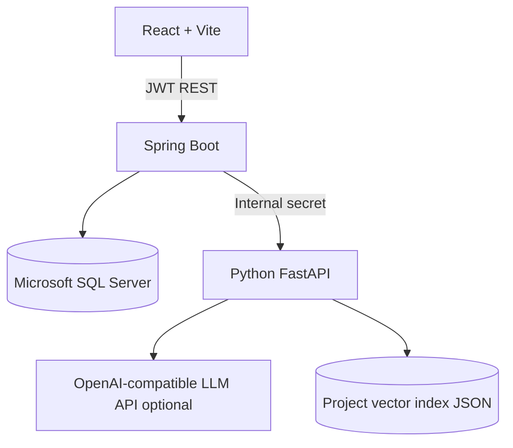

# KIẾN TRÚC VÀ PHÂN TÍCH NGHIỆP VỤ

## Phạm vi chức năng
- Đăng ký / đăng nhập JWT, mật khẩu BCrypt.
- Quản lý dự án, chủ sở hữu mời thành viên đã đăng ký bằng email.
- Quản lý yêu cầu: thêm / sửa / xóa (nếu không có User Story), phân loại/ưu tiên/trạng thái.
- Phân tích requirement: tóm tắt, FR/NFR, mơ hồ, thiếu thông tin, rủi ro, đề xuất.
- Tạo user story từ requirement (INVEST), acceptance criteria Given/When/Then.
- Quản lý sprint và task, phân công thành viên, lọc và kéo thả Kanban.
- Upload PDF/DOCX/TXT/MD, chia chunk + embedding, hỏi đáp RAG theo project, trả nguồn và trang (PDF).

## Vai trò
- Chủ dự án (OWNER): tạo và sửa project, mời thành viên.
- Thành viên (MEMBER): đọc/sửa yêu cầu, story, task, sprint và tài liệu trong project mà họ tham gia.
- Người ngoài project: không có quyền đọc hoặc ghi bất kỳ tài nguyên nào thuộc project.

## Sơ đồ hệ thống

## Quan hệ dữ liệu
`User 1-N Project(owner)`, `User N-N Project qua ProjectMember`, `Project 1-N Requirement`,
`Requirement 1-N UserStory`, `UserStory 1-N AcceptanceCriterion`, `Project 1-N Sprint`,
`Project 1-N Task`, `Task N-1 Sprint (nullable)`, `Task N-1 Story (nullable)`,
`Project 1-N Document`. Mọi mục con có `projectId` và được kiểm tra quyền.

## RAG indexing
1. Upload multipart có JWT lên Spring.
2. Spring kiểm tra membership và extension/kích thước rồi chuyển file đến FastAPI qua internal key.
3. FastAPI trích xuất văn bản (PDF hỗ trợ PDF có text, chưa hỗ trợ scanned PDF), chia ~1000 ký tự có overlap 160.
4. Nếu có API AI + embedding model: vector ngữ nghĩa do nhà cung cấp tạo. Nếu không: vector hashed token phục vụ tìm kiếm từ khóa.
5. Lưu `index.json` dưới `ai-service/data/<projectId>/`; chỉ Spring truy cập được dịch vụ nội bộ.
6. Câu hỏi được chuyển vector và tìm top-5 cosine. Truy hồi chỉ trong project_id được kiểm tra.
7. Nếu có LLM: gửi các đoạn trích vào prompt không tin cậy, yêu cầu trích dẫn [1], [2]. Nếu không: trả các đoạn nguồn, không gọi đó là câu trả lời AI.
8. Chat trả nguồn: filename, page (nếu PDF), chunk và excerpt.

## Quy trình nghiệp vụ
1. BA/PM tạo project.
2. BA nhập và phân loại requirement.
3. AI phân tích (người dùng rà soát), tạo user stories, tạo acceptance criteria (người dùng rà soát).
4. PM lập sprint, chuyển task vào sprint, phân công developer.
5. Developer cập nhật tiến độ trên Kanban.
6. Developer nạp tài liệu dự án, hỏi chatbot bằng RAG và kiểm chứng nguồn.

## Các lưu ý bảo mật / giới hạn
- API LLM là dịch vụ bên ngoài: chỉ gửi dữ liệu không nhạy cảm hoặc được phép gửi.
- API key, mật khẩu DB, JWT secret và internal key phải lưu biến môi trường, không commit.
- Chế độ `demo_rule_based` là giả lập nghiệp vụ, không phải LLM.
- Khi bật remote embeddings sau khi upload bằng mode lexical, cần upload lại để có vector ngữ nghĩa.
- Hash token RAG không hiệu quả bằng semantic embedding với diễn giải/paraphrase.
- Đây là kiến trúc phục vụ đồ án / bản chạy thử. Đưa vào production cần migrations Flyway, RBAC chi tiết hơn, audit log, virus scanning, rate limit, kiểm thử tích hợp, object storage, SQL TLS certificate hợp lệ.
